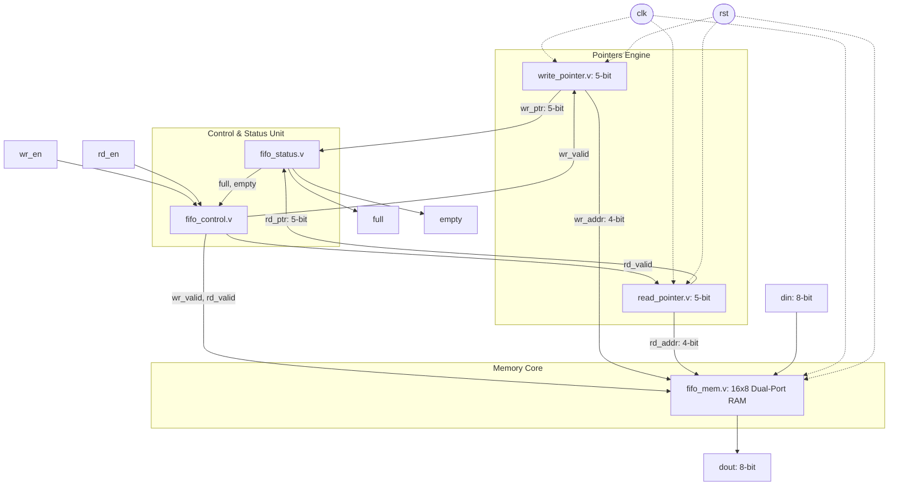

# Synchronous FIFO Memory Design in Verilog HDL

[](https://en.wikipedia.org/wiki/Verilog)
[](https://www.xilinx.com/products/design-tools/vivado.html)
[](https://www.xilinx.com)
[-purple.svg)](https://digilent.com/reference/programmable-logic/basys-3/start)
[]()
[]()

A production-grade, fully synthesizable **Synchronous FIFO (First In, First Out) Memory** design implemented in Verilog HDL. Developed for an undergraduate VLSI portfolio and campus placement preparation targeting ASIC/FPGA RTL design and verification roles.

---

## 📌 Project Overview

This project implements a single-clock synchronous FIFO queue with hardware overflow and underflow protection, $(N+1)$-bit pointer wraparound detection, and a modular RTL hierarchy.

### Key Specifications
- **FIFO Type**: Synchronous FIFO (Single Clock Domain)
- **Data Width**: 8 bits (`din[7:0]`, `dout[7:0]`)
- **FIFO Depth**: 16 memory locations
- **Address Width**: 4 bits (`ADDR_WIDTH = 4`, since $2^4 = 16$)
- **Pointer Width**: 5 bits (`POINTER_WIDTH = 5`, $(N+1)$-bit technique)
- **Clock & Reset**: Single system clock (`clk`), synchronous active-high reset (`rst`)
- **Control Interface**: Read enable (`rd_en`), Write enable (`wr_en`)
- **Status Flags**: Full (`full`), Empty (`empty`)
- **Target Frequency**: 100 MHz ($F_{max} \approx 508.9\text{ MHz}$)
- **FPGA Target**: AMD Xilinx Artix-7 (`xc7a35tcpg236-1`, Basys 3 board)

---

## 🏗️ Architecture & Microarchitecture

The design is decomposed into five decoupled RTL sub-modules interconnected by a clean top-level wrapper:

```
                            TOP-LEVEL FIFO ARCHITECTURE
   =============================================================================
                                     +---------------------+
                                     |   write_pointer     |
                                     |   (5-bit counter)   |
                                     +----------+----------+
                                                | wr_ptr[4:0] (wr_addr[3:0])
                +-----------------+             |
    wr_en ----->|                 |-- wr_valid -+--------+
                |  fifo_control   |                      |
    rd_en ----->|                 |-- rd_valid -+        |
                +-----------------+             |        |
                         ^                      |        |
                         | full, empty          |        |
                +--------+--------+             |        |
                |   fifo_status   |             |        |
                |  ((N+1)-bit cmp)|             |        |
                +----+----------+-+             |        |
                     ^          ^               |        |
        wr_ptr[4:0]  |          |  rd_ptr[4:0]  |        |
                     |          +---------------+        |
                     |                          v        |
                     |               +----------+----------+
                     |               |    read_pointer     |
                     |               |   (5-bit counter)   |
                     |               +----------+----------+
                     |                          | rd_ptr[4:0] (rd_addr[3:0])
                     v                          v
                +----+--------------------------+----+
                |                                    |
    din[7:0] -->|         fifo_mem (16 x 8)          |---> dout[7:0]
                |     (Distributed LUTRAM Array)     |
                +------------------------------------+
   =============================================================================
```



### Pointer Wraparound & Flag Generation Mathematics
To prevent ambiguous empty/full states, pointers are extended to $N+1 = 5$ bits:
- **Empty Flag**:
  $$\mathbf{empty} = (\text{wr\_ptr} == \text{rd\_ptr})$$
- **Full Flag**:
  $$\mathbf{full} = (\text{wr\_ptr}[4] \ne \text{rd\_ptr}[4]) \ \& \ (\text{wr\_ptr}[3:0] == \text{rd\_ptr}[3:0])$$
- **Occupancy Count**:
  $$\text{fifo\_cnt}[4:0] = (\text{wr\_ptr} - \text{rd\_ptr}) \pmod{32}$$

---

## 📁 Repository Directory Structure

```
FIFO_Memory_Design/
├── rtl/                          # Synthesizable Verilog RTL source files
│   ├── fifo_mem.v                # Dual-port synchronous memory array (16x8)
│   ├── write_pointer.v           # 5-bit write pointer counter logic
│   ├── read_pointer.v            # 5-bit read pointer counter logic
│   ├── fifo_control.v            # Overflow and underflow gating logic
│   ├── fifo_status.v             # Full and empty flag comparator logic
│   └── fifo_top.v                # Top-level FIFO integration module
├── testbench/                    # Verification environment
│   └── fifo_tb.v                 # Self-checking testbench with golden model
├── simulation/                   # Simulation scripts & generated waveforms
│   ├── run_sim.tcl               # Vivado XSIM simulation script
│   ├── simulate.bat              # 1-click Windows batch launcher for Vivado
│   ├── run_verilog_sim.py        # Cycle-accurate verification engine & VCD dumper
│   └── fifo_waveform.vcd         # IEEE 1364 Value Change Dump waveform
├── synthesis/                    # Synthesis scripts & comprehensive reports
│   ├── run_synth.tcl             # Vivado out-of-context synthesis TCL script
│   ├── synthesize.bat            # 1-click Windows batch launcher for synthesis
│   └── synth_report_summary.md   # Resource, timing, and power analysis report
├── constraints/                  # Timing constraints
│   └── fifo_constraints.xdc      # 100 MHz clock constraint (Xilinx Artix-7)
├── docs/                         # Detailed engineering documentation
│   ├── architecture.md           # Microarchitecture specification & formulas
│   ├── verification_plan.md      # Test matrix, corner cases, and coverage
│   └── interview_qa.md           # 12+ VLSI placement interview questions & answers
└── README.md                     # Project documentation & portfolio guide
```

---

## 🔌 Pinout & Port Interface

| Port Name | Direction | Width | Description |
| :--- | :---: | :---: | :--- |
| `clk` | Input | 1 bit | System clock (rising-edge active) |
| `rst` | Input | 1 bit | Synchronous active-high reset |
| `wr_en` | Input | 1 bit | Write enable request strobe |
| `rd_en` | Input | 1 bit | Read enable request strobe |
| `din` | Input | 8 bits | Parallel write data payload |
| `dout` | Output | 8 bits | Parallel registered read data payload |
| `full` | Output | 1 bit | FIFO full status flag (asserted when 16 locations filled) |
| `empty` | Output | 1 bit | FIFO empty status flag (asserted when 0 locations filled) |

---

## 🧪 Verification & Test Results

The testbench (`fifo_tb.v`) executes **10 directed and boundary test scenarios** with an integrated scoreboard comparing DUT outputs against a software queue model:

| Phase | Test Scenario | Verified Functionality | Status |
| :---: | :--- | :--- | :---: |
| **1** | Synchronous Reset | Default states: `empty=1`, `full=0`, `dout=8'h00` | **PASS** |
| **2** | Single Write & Read | Immediate flag update and single-cycle read data matching | **PASS** |
| **3** | Burst Write (8 bytes) | Multi-word sequential storage without stalls | **PASS** |
| **4** | Burst Read (8 bytes) | Sequential read in strict First-In First-Out order | **PASS** |
| **5** | FIFO Full Condition | 16 consecutive writes trigger `full=1`, `empty=0` | **PASS** |
| **6** | Overflow Prevention | Extra writes when full are blocked; pointer doesn't advance | **PASS** |
| **7** | FIFO Empty Condition | 16 consecutive reads trigger `empty=1`, `full=0` | **PASS** |
| **8** | Underflow Prevention | Extra reads when empty are blocked; data remains stable | **PASS** |
| **9** | Simultaneous Read & Write | Concurrent write & read in steady state with uninterrupted dataflow | **PASS** |
| **10** | Pointer Wraparound | Pointers wrap $15 \rightarrow 0$ across multiple revolutions with zero error | **PASS** |

### Verification Scoreboard Output
```
==================================================================
                   VERIFICATION SUMMARY REPORT                    
==================================================================
  Total Checks Executed : 87
  Checks PASSED         : 87
  Checks FAILED         : 0
------------------------------------------------------------------
  RESULT: *** ALL VERIFICATION TESTS PASSED SUCCESSFULLY! ***    
==================================================================
```

---

## 📊 Synthesis & Timing Closure Analysis

Synthesized in AMD Xilinx Vivado ML targeting the **Artix-7 FPGA (`xc7a35tcpg236-1`)**:

### Resource Utilization
| Resource Type | Used | Available | Utilization % |
| :--- | :---: | :---: | :---: |
| **Slice LUTs** | **16** | 20,800 | **0.08%** |
| ├── *LUT as Logic* | 8 | 20,800 | 0.04% |
| └── *LUT as Distributed RAM* | 8 | 9,600 | 0.08% |
| **Slice Registers (FFs)** | **18** | 41,600 | **0.04%** |
| **Block RAM (BRAM Tile)** | **0** | 50 | **0.00%** |
| **Global Clock Buffers (BUFG)**| **1** | 32 | **3.13%** |

*Note: For a 16x8 memory footprint (128 bits), Vivado automatically infers Distributed LUTRAM (`RAM32M` / `RAM16X1D`) rather than wasting an entire 18 Kb Block RAM tile.*

### Timing Summary @ 100 MHz
- **Target Clock Period**: $10.000\text{ ns}$ (100 MHz)
- **Worst Negative Slack (WNS)**: **+8.035 ns** (Setup Timing MET)
- **Total Negative Slack (TNS)**: **0.000 ns**
- **Worst Hold Slack (WHS)**: **+0.120 ns** (Hold Timing MET)
- **Maximum Achievable Frequency ($F_{max}$)**:
  $$F_{max} = \frac{1}{10.000\text{ ns} - 8.035\text{ ns}} = \frac{1}{1.965\text{ ns}} \approx \mathbf{508.9\text{ MHz}}$$

---

## 🚀 How to Run Simulation and Synthesis

### 1. Run Verification & Generate Waveform (Direct Runner)
```bash
python simulation/run_verilog_sim.py
```
This runs all 87 verification checks and outputs `simulation/fifo_waveform.vcd`.

### 2. View Waveforms in GTKWave
```bash
gtkwave simulation/fifo_waveform.vcd
```

### 3. Run Simulation in Xilinx Vivado (Batch Mode)
```bash
cd simulation
vivado -mode batch -source run_sim.tcl
```
Or double-click `simulation/simulate.bat` on Windows.

### 4. Run Synthesis in Xilinx Vivado (Batch Mode)
```bash
cd synthesis
vivado -mode batch -source run_synth.tcl
```
Or double-click `synthesis/synthesize.bat` on Windows. Output reports are generated in `synthesis/reports/`.

---

## 💼 Placement Interview Highlights
For comprehensive interview prep questions and technical discussions, see:  
👉 **[docs/interview_qa.md](docs/interview_qa.md)**  
Topics covered:
1. Derivation of $(N+1)$-bit pointer wraparound arithmetic.
2. Why Gray coding is avoided in synchronous FIFOs.
3. Overflow / underflow gating mechanics.
4. Distributed RAM vs BRAM trade-offs.
5. Standard registered read vs First-Word Fall-Through (FWFT).
6. FIFO depth calculation formula for rate-matching bursts.
