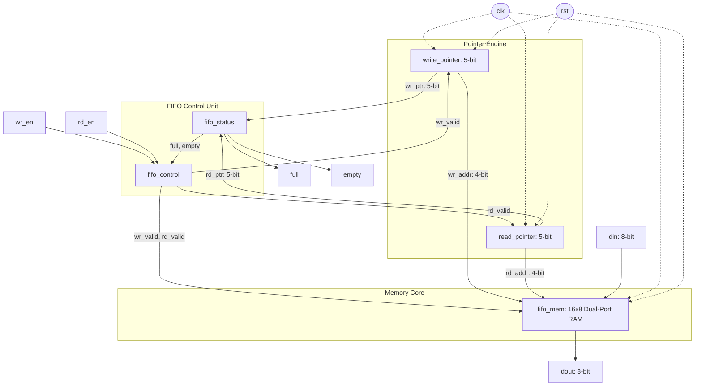

# Synchronous FIFO Memory Architecture Specification

## 1. Overview and Specifications

A **Synchronous FIFO (First In, First Out)** is an elastic data buffer operating within a **single clock domain**. It temporarily queues digital data between producer and consumer logic running synchronously, decoupling burst transactions and smoothing data flow.

### Key Parameter Specifications
| Parameter | Value | Description |
| :--- | :---: | :--- |
| **FIFO Type** | Synchronous | Single clock domain (`clk`), synchronous active-high reset (`rst`) |
| **Data Width (`DATA_WIDTH`)** | 8 bits | Width of data words stored and transmitted (`din[7:0]`, `dout[7:0]`) |
| **FIFO Depth (`DEPTH`)** | 16 locations | Number of storage words available in memory |
| **Address Width (`ADDR_WIDTH`)** | 4 bits | Address lines required to index 16 locations ($\log_2(16) = 4$) |
| **Pointer Width (`POINTER_WIDTH`)** | 5 bits | Address width + 1 bit for wraparound detection ($4 + 1 = 5$) |
| **Target Technology** | Xilinx Artix-7 | Synthesizable on standard FPGA architectures (Basys 3, Nexys 4) |

---

## 2. Microarchitecture Block Diagram

```
                                 SYNCHRONOUS FIFO TOP-LEVEL
      ==================================================================================
                                            +---------------------+
                                            |   Write Pointer     |
                                            |   (5-bit counter)   |
                                            +----------+----------+
                                                       | wr_ptr[4:0]
                                                       | (wr_addr = wr_ptr[3:0])
                    +--------------------+             |
        wr_en ----->|                    |-- wr_valid -+--------+
                    |    FIFO Control    |                      |
        rd_en ----->|       Logic        |-- rd_valid -+        |
                    | (Overflow/Underflow|             |        |
                    +--------------------+             |        |
                               ^                       |        |
                               | full, empty           |        |
                               |                       |        |
                    +----------+---------+             |        |
                    |    FIFO Status     |             |        |
                    |     (Comparator)   |             |        |
                    +----+-------------+-+             |        |
                         ^             ^               |        |
            wr_ptr[4:0]  |             |  rd_ptr[4:0]  |        |
                         |             +---------------+        |
                         |                             |        |
                         |                             v        |
                         |                  +----------+----------+
                         |                  |    Read Pointer     |
                         |                  |   (5-bit counter)   |
                         |                  +----------+----------+
                         |                             | rd_ptr[4:0]
                         |                             | (rd_addr = rd_ptr[3:0])
                         |                             |
                         v                             v
                    +----+-----------------------------+----+
                    |                                       |
        din[7:0] -->|         Dual-Port Memory Array        |---> dout[7:0]
                    |               (16 x 8)                |
                    +---------------------------------------+
      ==================================================================================
```

### Mermaid Architectural Diagram


---

## 3. Modular RTL Architecture

### Module 1: `fifo_mem.v` (Dual-Port Memory Core)
- **Role**: High-speed synchronous storage array of $16 \times 8$-bit registers.
- **Write Port**:
  - Activated synchronously on `clk` when `wr_valid` is asserted.
  - Data at `din[7:0]` is written to `mem[wr_addr]`.
- **Read Port**:
  - Synchronous registered read port with synchronous reset.
  - When `rd_valid` is asserted, data from `mem[rd_addr]` is latched into `dout` at the subsequent rising edge of `clk`.
  - When `rst` is asserted, `dout` resets to `8'h00`.
- **Hardware Mapping**: Automatically synthesized as Distributed LUTRAM (`RAM32M` / `RAM16X1D` primitives) on Xilinx 7-series FPGAs.

### Module 2: `write_pointer.v` (Write Pointer Logic)
- **Role**: Tracks the next memory location to be written.
- **Bit-Width**: 5 bits (`POINTER_WIDTH = ADDR_WIDTH + 1 = 5`).
- **Operation**:
  - Synchronous counter incremented by $1$ on each `posedge clk` when `wr_valid = 1`.
  - Memory write address: `wr_addr = wr_ptr[3:0]`.
  - Wrap indicator: `wr_ptr[4]` (MSB).

### Module 3: `read_pointer.v` (Read Pointer Logic)
- **Role**: Tracks the next memory location to be read.
- **Bit-Width**: 5 bits (`POINTER_WIDTH = ADDR_WIDTH + 1 = 5`).
- **Operation**:
  - Synchronous counter incremented by $1$ on each `posedge clk` when `rd_valid = 1`.
  - Memory read address: `rd_addr = rd_ptr[3:0]`.
  - Wrap indicator: `rd_ptr[4]` (MSB).

### Module 4: `fifo_control.v` (Control & Protection Logic)
- **Role**: Generates qualified enable strobes to prevent illegal operations.
- **Overflow Prevention**:
  $$\text{wr\_valid} = \text{wr\_en} \ \& \ \sim\text{full}$$
  If the FIFO is full (`full = 1`), external `wr_en` requests are gated off, preventing pointer advancement and protecting stored data from corruption.
- **Underflow Prevention**:
  $$\text{rd\_valid} = \text{rd\_en} \ \& \ \sim\text{empty}$$
  If the FIFO is empty (`empty = 1`), external `rd_en` requests are gated off, preventing pointer advancement and invalid memory reads.

### Module 5: `fifo_status.v` (Flag Detection Logic)
- **Role**: Evaluates the full and empty conditions in pure combinational logic using the $(N+1)$-bit pointer technique.

---

## 4. Mathematical Foundation: $(N+1)$-Bit Pointer Technique

### The FIFO Ambiguity Problem
In an $N$-bit addressed buffer ($2^N$ depth), both the empty and full states occur when the write address equals the read address:
$$\text{wr\_addr} == \text{rd\_addr}$$
Without extra state information, hardware cannot determine if the FIFO is completely empty (0 items) or completely full ($2^N$ items).

### The $(N+1)$-Bit Solution
By extending pointer width by **1 extra Most Significant Bit (MSB)** ($N+1 = 5$ bits for $N=4$):
- Range of pointers: $0$ to $2 \times \text{DEPTH} - 1$ ($0$ to $31$).
- The lower $N$ bits (`[3:0]`) represent the physical memory address ($0$ to $15$).
- The MSB (`bit[4]`) acts as a **wraparound / buffer revolution indicator**.

### Empty Condition
The FIFO is **empty** when the write pointer and read pointer are **completely identical in all $N+1$ bits**:
$$\mathbf{empty} = (\text{wr\_ptr} == \text{rd\_ptr})$$
*Explanation*: The write pointer and read pointer point to the exact same physical address and have traversed through the memory buffer the exact same number of times.

### Full Condition
The FIFO is **full** when:
1. The lower $N$ memory address bits match: $\text{wr\_ptr}[3:0] == \text{rd\_ptr}[3:0]$
2. The MSBs (wrap bits) differ: $\text{wr\_ptr}[4] \ne \text{rd\_ptr}[4]$
$$\mathbf{full} = (\text{wr\_ptr}[4] \ne \text{rd\_ptr}[4]) \ \& \ (\text{wr\_ptr}[3:0] == \text{rd\_ptr}[3:0])$$
*Explanation*: The write pointer has cycled through the memory array and caught up to the read pointer from behind, meaning all 16 locations are occupied.

### Occupancy Count Formula
The instantaneous number of stored words ($0$ to $16$) is computed by modular subtraction:
$$\text{fifo\_cnt}[4:0] = (\text{wr\_ptr}[4:0] - \text{rd\_ptr}[4:0]) \pmod{32}$$

---

## 5. Waveform Timing Diagrams

### 5.1 Single Write Followed by Single Read
```
             __    __    __    __    __    __    __    __
clk       __|  \__/  \__/  \__/  \__/  \__/  \__/  \__/  \__
rst       __________________________________________________
wr_en     ______/-----\_____________________________________
din       xxxxxx< A5  >xxxxxxxxxxxxxxxxxxxxxxxxxxxxxxxxxxxxx
wr_ptr    00000 | 00001
empty     ------\_______________________/-------------------
rd_en     ________________________/-----\___________________
dout      000000000000000000000000< A5  >-------------------
rd_ptr    00000                   | 00001
```

### 5.2 Simultaneous Read and Write Operation
When the FIFO contains intermediate data (e.g., occupancy = 4):
- `wr_en = 1` and `rd_en = 1` are driven simultaneously in the same cycle.
- `din = B0` is written to `mem[wr_addr]`, and `wr_ptr` increments.
- `mem[rd_addr]` is read into `dout`, and `rd_ptr` increments.
- Net occupancy remains constant ($4 + 1 - 1 = 4$).
- Throughput is maintained at **1 transaction per clock cycle**.
